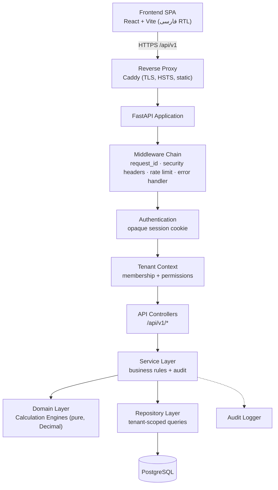

# معماری MarginPilot — نسخه ۱ (Phase 1)

**وضعیت:** طراحی تأییدشدهٔ Phase 1 — هنوز هیچ قابلیتی پیاده‌سازی نشده است.
**اصول حاکم:** Modular Monolith، تفکیک لایه‌ها، محاسبات مالی Deterministic، Decimal برای پول، امنیت از ابتدا، بدون Abstraction غیرضروری.

---

## ۱) نمای کلی

MarginPilot یک Modular Monolith تک‌ریپویی (monorepo) با Backend فارسی‌محور و Frontend SPA است. همهٔ ماژول‌ها در یک فرایند FastAPI اجرا می‌شوند و مرز ماژول‌ها با قوانین import سخت‌گیرانه (نه شبکه) حفظ می‌شود. در نسخهٔ ۱ هیچ Microservice، Message Broker یا Redis اجباری وجود ندارد.



### مسئولیت لایه‌ها

| لایه | مسئولیت | مسئولیت‌های ممنوع |
|---|---|---|
| Frontend | نمایش، فرم و اعتبارسنجی UX، نمودار، مدیریت state رابط | هیچ منطق مالی؛ هیچ محاسبهٔ قیمت/سود |
| Middleware | request_id، security headers، rate limit، handler خطای سراسری، CORS | منطق تجاری |
| API Layer | سریالایز/دیسریالایز با Pydantic، فراخوانی Service، mapping خطا | دسترسی مستقیم به Repository/DB |
| Service Layer | قوانین تجاری، تراکنش، فراخوانی سرویس ماژول‌های دیگر، ثبت Audit | SQL دستی خارج از Repository |
| Domain Layer | فرمول‌های مالی خالص (Decimal)، تخصیص هزینه، تطبیق قیمت | وابستگی به DB و Framework (واردات fastapi/sqlalchemy ممنوع) |
| Repository Layer | کوئری‌های scoped با tenant_id، ترجمهٔ ORM | قوانین تجاری |
| Database | ذخیرهٔ پایدار، constraintها، indexها | منطق |

---

## ۲) چرخهٔ یک درخواست (Request Lifecycle)

1. Caddy TLS را خاتمه می‌دهد و به backend می‌فرستد (پشت آن HTTP داخلی).
2. Middleware‌ها به ترتیب: تخصیص `request_id` (UUID) → security headers → rate limit → CORS.
3. احراز هویت: خواندن کوکی `mp_session`، هش SHA-256 و جستجو در `sessions`؛ بررسی انقضای idle/absolute و `revoked_at` → آبجکت کاربر.
4. Tenant Context: tenant فعال داخل نشست ذخیره شده است؛ عضویت و نقش از `memberships` خوانده و `TenantContext(tenant_id, role, permissions)` ساخته می‌شود.
5. برای متدهای unsafe: بررسی CSRF (توکن متصل به نشست + Origin) طبق `security.md §۲`.
6. Routing → Controller: اعتبارسنجی ورودی با Pydantic → فراخوانی Service.
7. Service: قوانین تجاری، تراکنش، ثبت Audit برای تغییرات، فراخوانی Domain (محاسبات) یا Repository.
8. Repository: فقط کوئری‌های دارای `tenant_id`.
9. پاسخ استاندارد + لاگ ساختاری (`request_id, user_id, tenant_id, path, method, status, duration_ms`).
10. Handler خطای سراسری: هر استثنا به Error Schema نگاشت می‌شود؛ **هرگز** stack trace یا جزئیات داخلی به کاربر نمی‌رسد (جزئیات در لاگ با request_id).

---

## ۳) ساختار پوشه‌ها (قرارداد نهایی)

اسکلت backend اکنون ایجاد شده (فقط `__init__.py`، بدون کد). Frontend در Phase 2 با ابزارهایش ساخته می‌شود.

```
marginpilot/
├── backend/
│   ├── app/
│   │   ├── main.py                  # (Phase 2) ساخت app، middlewareها، routerها
│   │   ├── core/                    # config، db، security primitives، money، errors، logging
│   │   ├── modules/
│   │   │   ├── identity/            # auth، users، sessions، password reset
│   │   │   ├── tenancy/             # tenants، memberships، TenantContext، RBAC
│   │   │   ├── catalog/             # categories، products، variants، suppliers، price lists
│   │   │   ├── sales/               # orders، sale_items، returns، status transitions
│   │   │   ├── expenses/            # expense types + allocation strategies
│   │   │   ├── imports/             # state machine ورود داده CSV/XLSX
│   │   │   ├── pricing/             # موتور محاسبه خالص + قیمت پیشنهادی + formula registry
│   │   │   ├── comparison/          # مقایسهٔ لیست قیمت تأمین‌کنندگان
│   │   │   ├── analytics/           # گزارش‌های تجمیعی (فقط از موتور pricing تغذیه می‌شود)
│   │   │   ├── reporting/           # PDF/XLSX/CSV + متادیتای گزارش
│   │   │   └── audit/               # audit_logs
│   │   └── api/v1/                  # routerها و schemaهای Pydantic
│   ├── alembic/                     # (Phase 3) migrations
│   ├── tests/                       # (فازهای بعد) unit / integration / security
│   └── pyproject.toml               # (Phase 2) وابستگی‌های pin شده
├── frontend/                        # (Phase 2) Vite + React + TS + Tailwind + RTL
│   └── src/{features,components,lib,routes}/
├── docs/                            # همین سندها
├── docker-compose.yml               # (Phase 2)
├── .github/workflows/ci.yml         # (Phase 2)
├── .env.example                     # ✅ موجود — بدون Secret
└── README.md / SECURITY.md / CHANGELOG.md   # (SECURITY.md و CHANGELOG.md در Phase 2)
```

---

## ۴) نقشهٔ ماژول‌ها

| ماژول | مسئولیت | موجودیت‌های متعلق | مصرف‌کننده‌های مجاز |
|---|---|---|---|
| identity | ثبت‌نام، ورود، نشست، تغییر/بازیابی رمز | users، sessions، password_reset_tokens | همه (از طریق core/auth) |
| tenancy | tenant، عضویت، TenantContext، نقش/مجوز | tenants، memberships، roles، permissions، tenant_settings | همه |
| catalog | دسته، محصول، واریانت، تأمین‌کننده، لیست قیمت | categories، products، product_variants، suppliers، supplier_price_lists، supplier_prices | sales، imports، comparison، pricing، analytics |
| sales | سفارش، اقلام، مرجوعی، گذار وضعیت | sales_orders، sale_items | pricing، analytics، imports، reporting |
| expenses | ثبت هزینه، تخصیص شفاف | expenses | pricing، analytics، reporting |
| imports | آپلود → parse → map → validate → confirm → commit | imports، import_rows | — (خودش از سرویس catalog/sales برای commit استفاده می‌کند) |
| pricing | موتور محاسبهٔ خالص سود/حاشیه/قیمت پیشنهادی + formula_version | calculations | analytics، reporting، sales API، pricing API |
| comparison | مقایسهٔ دو لیست قیمت، تطبیق مطمئن/نامطمئن | comparison_runs، comparison_matches | API |
| analytics | تجمیع فقط از موتور pricing | — (stateless) | API |
| reporting | تولید PDF/XLSX/CSV با متادیتا | reports | API |
| audit | ثبت رخدادهای حساس | audit_logs | همهٔ Serviceها |

---

## ۵) قوانین وابستگی بین ماژول‌ها (سخت‌گیرانه)

1. جهت وابستگی فقط: `api → service → (domain | repository) → db`. برگشت ممنوع.
2. هر ماژول آزادانه `core` را import می‌کند؛ `core` هرگز ماژول‌ها را import نمی‌کند.
3. ارتباط بین ماژول‌ها **فقط** از طریق توابع عمومی سرویس ماژول مقصد (`modules/<m>/service.py`). import مستقیم model یا repository ماژول دیگر **ممنوع**.
4. واردات دایره‌ای ممنوع؛ از Phase 2 با `import-linter` در CI به‌صورت خودکار کنترل می‌شود.
5. Domain (موتور محاسبه) کاملاً خالص است: بدون DB، بدون FastAPI، فقط `Decimal` و انواع دادهٔ ساده؛ تست‌پذیری صددرصدی Unit.
6. مدل ORM متعلق به ماژول تعریف‌کنندهٔ آن است؛ join بین‌ماژولی در سطح ORM ممنوع — از سرویس ماژول مالک پرس‌وجو شود.
7. جداسازی tenant فقط با فیلتر کد نیست: **FKهای مرکب tenant-aware در سطح DB** تضمین می‌کنند رکورد یک tenant هرگز به والد tenant دیگر ارجاع نشود (`data-model.md §۴` — ۲۴ FK مرکب).

**هزینهٔ کنترل:** کم (یک config برای import-linter). **نفع:** مرزهای ماژول واقعی می‌مانند و در آینده استخراج سرویس جدا (در صورت نیاز) ممکن می‌شود — بدون آن‌که امروز پیچیدگی بسازد.

---

## ۶) قرارداد بین‌ماژولی (Public Service Interfaces — v1)

| ماژول تولیدکننده | قرارداد عمومی (امضای منطقی) | مصرف‌کننده |
|---|---|---|
| identity | `authenticate(email, password) -> SessionToken` ، `resolve_session(token) -> SessionCtx` ، `revoke_session(id, reason)` ، `revoke_all_for_user(user_id)` | core/auth، api |
| tenancy | `TenantContext` (tenant_id, role, permissions) ، `require_membership(user_id, tenant_id) -> Membership` ، `switch_active_tenant(session, tenant_id)` | همهٔ Serviceها |
| catalog | `get_product(tenant_id, id) / find_by_sku(tenant_id, sku)` ، `list_products(filters)` ، `add_price_list(...)` ، `lowest_supplier_price(tenant_id, product_id)` | sales، imports، comparison، pricing |
| sales | `get_order(tenant_id, id)` ، `list_orders(filters)` ، `register_return(order_id, items)` | pricing، analytics، reporting |
| expenses | `list_for_orders(tenant_id, order_ids)` ، `list_for_period(tenant_id, start, end)` ، `AllocationStrategy.allocate(expense, base_lines) -> [allocated]` | pricing، analytics |
| pricing | `calc_sale_item(...) -> ItemProfit` ، `calc_order(order, allocations) -> OrderProfit` ، `calc_period(filters) -> PeriodReport` ، `suggest_price(cost, target_margin) -> Money` | analytics، reporting، api/sales، api/pricing |
| comparison | `run_comparison(base_list_id, target_list_id, strategy) -> RunResult` ، `confirm_matches(run_id, decisions)` | api |
| imports | `create_from_upload(file, kind) -> Import` ، `apply_mapping(import_id, mapping) -> ValidationReport` ، `confirm(import_id) -> CommitResult` | api |
| analytics | `summary(filters)` ، `top_products(filters)` ، `trends(group_by)` | api |
| reporting | `generate(report_type, params, format) -> Report` | api |

همهٔ امضاها tenant-scoped هستند؛ هیچ قراردادی بدون `tenant_id` کار نمی‌کند. (ماژول billing طبق بازبینی از ساختار v1 حذف شد — ADR-013.)

---

## ۷) پیکربندی، لاگ و خطا (خلاصه)

- **پیکربندی:** فقط از متغیرهای محیطی با `pydantic-settings`؛ در startup به‌صورت fail-fast اعتبارسنجی می‌شود؛ نام‌ها و مقادیر نمونه در `.env.example` است. هیچ Secret در کد یا ریپو نیست.
- **لاگ ساختاری:** JSON با فیلدهای `ts, level, event, request_id, user_id, tenant_id, path, status, duration_ms`؛ دادهٔ حساس (رمز، توکن، کوکی، PII) هرگز لاگ نمی‌شود؛ فیلتر redact در middleware.
- **خطاها:** استثناهای دامنه → Error Schema یکسان (بخش خطاهای `api-contract.md`)؛ 500 بدون جزئیات داخلی + ثبت کامل در لاگ با request_id.

---

## ۸) نسخه‌بندی و سازگاری

- API: پیشوند `/api/v1`؛ تغییرات ناسازگار در `/api/v2` (در v1 فقط طرح).
- `formula_version` برای موتور محاسبه: نسخهٔ جاری `FV-2` (جزئیات و changelog در `calculation-principles.md`)؛ هر تغییر معنایی فرمول، نسخهٔ جدید و ثبت در `calculations`.
- Migrationها با Alembic، فقط رو به جلو برای استقرار، با اسکریپت downgrade قابل آزمایش.

---

## ۹) اینکه عمداً «انجام نشده» (مطابق شرط C و D)

- هیچ Redis، Celery، EventBus، DI framework سنگین، CQRS یا Microservice در v1 نیست.
- پرداخت واقعی، اشتراک، AI، اپ موبایل: خارج از scope نسخهٔ ۱ — ماژول billing طبق بازبینی از ساختار حذف شد و فقط به‌عنوان scope آینده مستند است (ADR-013، data-model §۹).
- هیچ فایل/کلاس «احتیاطی» که الان مصرف‌کننده ندارد ساخته نمی‌شود.
