# مدل داده MarginPilot — ERD و مشخصات جداول (نسخهٔ اصلاح‌شدهٔ بازبینی Phase 1)

**وضعیت:** طراحی اصلاح‌شده بر اساس بازبینی فنی (دور دوم — اصلاحات نهایی). تغییرات کلیدی نسبت به نسخهٔ قبل: جداسازی tenant در سطح **DB با FKهای مرکب**، جداول جدید `product_price_history` و `idempotency_keys`، **موجودیت‌های مستقل مرجوعی (`sales_returns`/`sales_return_items`)**، **FK سه‌ستونهٔ variant↔product**، حذف `supplier_id` از supplier_prices، رفع یکتایی دسته‌های ریشه و قواعد SKU، قواعد صریح یکتایی supplier_prices، شفاف‌سازی ارز و نقش‌های سراسری. DDL واقعی با Alembic به‌صورت مرحله‌ای در Phase 3 و Phase 4 پیاده‌سازی می‌شود؛ این سند قرارداد مدل است.
**Table count:** 30 tables (11 global + 19 tenant-scoped) - 50 ERD relationships - 25 tenant-aware composite FKs.

## ۱) اصول کلی

- **دو کلاس جدول:** «سراسری» (متعلق به پلتفرم: کاربران، نقش‌ها، tenantها و…) و «متعلق به tenant» (هر رکوردش متعلق به یک tenant است). جدول‌بندی کامل در §۲.
- **پول:** `NUMERIC(20,2)` مبالغ؛ `NUMERIC(12,6)` نرخ/درصد؛ واحد پول در سطح tenant (§۷ ارز).
- **حذف:** Soft delete فقط برای products، product_variants، suppliers، categories (`deleted_at`). **سوابق مالی** (sales_orders، sale_items، sales_returns, sales_refunds، expenses) هرگز hard delete نمی‌شوند؛ ابطال فقط با وضعیت + Audit.
- **Timestamps:** همهٔ جداول `created_at` (+ `updated_at` برای رکوردهای به‌روزرسانی‌پذیر) — timestamptz، UTC.
- **کلیدها:** PK عددی `bigint identity` برای موجودیت‌های دامنه؛ `sessions` UUID. توکن نشست/CSRF/reset فقط به‌صورت **هش** ذخیره می‌شوند.
- **بدون Trigger در v1:** یکپارچگی بین‌جدولی (جز FK) با validation سرویس + تست integration تضمین می‌شود؛ تصمیم مستند برای سادگی و دیباگ‌پذیری.

## ۲) طبقه‌بندی جداول: سراسری vs متعلق به tenant

| کلاس | جداول | کلید مرجع tenant |
|---|---|---|
| **سراسری (۱۱)** | users، roles، permissions، role_permissions، tenants، tenant_settings، memberships، sessions، password_reset_tokens، audit_logs، idempotency_keys | `tenant_id` تک‌ستونه (وقتی معنا دارد) |
| **متعلق به tenant (۱۹)** | categories، products، product_price_history، product_variants، suppliers، supplier_price_lists، supplier_prices، sales_orders، sale_items، **sales_returns، sales_return_items, sales_refunds**، expenses، imports، import_rows، calculations، reports، comparison_runs، comparison_matches | `tenant_id NOT NULL` + FK مرکب به والد (§۴) |

`memberships` جدول اتصال سراسری user↔tenant است؛ `sessions` سراسری است و `tenant_id` آن با اعتبارسنجی membership در سرویس معتبر می‌شود (FK از جنس متقاطع نمی‌تواند این را تضمین کند — مستند).

## ۳) ERD

```mermaid
erDiagram
    users ||--o{ memberships : has
    tenants ||--o{ memberships : has
    roles ||--o{ memberships : grants
    roles ||--o{ role_permissions : includes
    permissions ||--o{ role_permissions : in
    users ||--o{ sessions : owns
    tenants ||--o{ sessions : "active tenant"
    users ||--o{ password_reset_tokens : requests
    tenants ||--o{ tenant_settings : configures
    users ||--o{ audit_logs : "actor nullable"
    tenants ||--o{ audit_logs : logs
    tenants ||--o{ idempotency_keys : scopes
    users ||--o{ idempotency_keys : issued_by
    tenants ||--o{ categories : owns
    categories ||--o{ categories : parent
    tenants ||--o{ products : owns
    categories ||--o{ products : classifies
    products ||--o{ product_variants : has
    tenants ||--o{ product_price_history : owns
    products ||--o{ product_price_history : records
    supplier_prices ||--o{ product_price_history : "cost provenance"
    users ||--o{ product_price_history : changed_by
    tenants ||--o{ suppliers : owns
    suppliers ||--o{ supplier_price_lists : provides
    supplier_price_lists ||--o{ supplier_prices : contains
    products ||--o{ supplier_prices : "matched to"
    tenants ||--o{ sales_orders : owns
    sales_orders ||--o{ sale_items : contains
    products ||--o{ sale_items : "sold as"
    product_variants ||--o{ sale_items : "sold as variant"
    sales_orders ||--o{ sales_returns : "has physical returns"
    sales_orders ||--o{ sales_refunds : "has independent refunds"
    users ||--o{ sales_returns : registered_by
    users ||--o{ sales_refunds : registered_by
    sales_returns ||--o{ sales_return_items : contains
    sale_items ||--o{ sales_return_items : "returned via"
    tenants ||--o{ expenses : owns
    sales_orders ||--o{ expenses : "order-scoped"
    products ||--o{ expenses : "product-scoped"
    tenants ||--o{ imports : runs
    imports ||--o{ import_rows : contains
    users ||--o{ imports : created_by
    tenants ||--o{ calculations : journals
    users ||--o{ calculations : created_by
    tenants ||--o{ reports : requests
    users ||--o{ reports : requested_by
    tenants ||--o{ comparison_runs : runs
    comparison_runs ||--o{ comparison_matches : produces
    supplier_price_lists ||--o{ comparison_matches : "from"
    products ||--o{ comparison_matches : "linked to"
```

## ۴) جداسازی tenant در سطح دیتابیس — FKهای مرکب tenant-aware

**اصل:** فیلتر کردن کوئری در کد به‌تنهایی کافی نیست؛ PostgreSQL خودش باید جلوی ارجاع رکورد Tenant A به والد Tenant B را بگیرد. اجرا با **FK مرکب `(tenant_id, parent_id)`** به‌جای FK تک‌ستونه روی id والد.

**پیش‌نیاز:** هر جدولِ والدِ متعلق به tenant باید `UNIQUE (tenant_id, id)` داشته باشد (اندیس یگانه مکمل PK) تا هدف FK مرکب باشد.

| # | جدول فرزند | ستون‌های FK مرکب | ارجاع به |
|---|---|---|---|
| 1 | sale_items | (tenant_id, order_id) | sales_orders (tenant_id, id) |
| 2 | sale_items | (tenant_id, product_id) nullable | products (tenant_id, id) |
| 3 | sale_items | (tenant_id, product_id, variant_id) nullable **سه‌ستونه** | product_variants (tenant_id, product_id, id) — variant حتماً متعلق به همان product |
| 4 | products | (tenant_id, category_id) nullable | categories (tenant_id, id) |
| 5 | product_variants | (tenant_id, product_id) | products (tenant_id, id) |
| 6 | categories | (tenant_id, parent_id) nullable | categories (tenant_id, id) |
| 7 | supplier_price_lists | (tenant_id, supplier_id) | suppliers (tenant_id, id) |
| 8 | supplier_prices | (tenant_id, price_list_id) | supplier_price_lists (tenant_id, id) — تأمین‌کننده از طریق لیست استخراج می‌شود (ستون supplier_id در supplier_prices **حذف شد**) |
| 9 | supplier_prices | (tenant_id, product_id) nullable | products (tenant_id, id) |
| 10 | expenses | (tenant_id, order_id) nullable | sales_orders (tenant_id, id) |
| 11 | expenses | (tenant_id, product_id) nullable | products (tenant_id, id) |
| 12 | comparison_runs | (tenant_id, base_list_id) | supplier_price_lists (tenant_id, id) |
| 13 | comparison_runs | (tenant_id, target_list_id) | supplier_price_lists (tenant_id, id) |
| 14 | comparison_matches | (tenant_id, run_id) | comparison_runs (tenant_id, id) |
| 15 | comparison_matches | (tenant_id, base_price_id) nullable | supplier_prices (tenant_id, id) |
| 16 | comparison_matches | (tenant_id, target_price_id) nullable | supplier_prices (tenant_id, id) |
| 17 | comparison_matches | (tenant_id, suggested_product_id) nullable | products (tenant_id, id) |
| 18 | comparison_matches | (tenant_id, confirmed_product_id) nullable | products (tenant_id, id) |
| 19 | import_rows | (tenant_id, import_id) | imports (tenant_id, id) |
| 20 | product_price_history | (tenant_id, product_id) | products (tenant_id, id) |
| 21 | product_price_history | (tenant_id, supplier_price_id) nullable | supplier_prices (tenant_id, id) — provenance وقتی بهای مرجع از قیمت تأمین‌کننده تنظیم شده |
| 22 | sales_returns | (tenant_id, order_id) | sales_orders (tenant_id, id) |
| 23 | sales_return_items | (tenant_id, return_id) | sales_returns (tenant_id, id) |
| 24 | sales_return_items | (tenant_id, sale_item_id) | sale_items (tenant_id, id) |
| 25 | sales_refunds | (tenant_id, order_id) | sales_orders (tenant_id, id) |

> جمع نهایی: **۲۴ FK مرکب tenant-aware**.
> **رفتار FK مرکب با ستون اختیاری:** به‌صورت پیش‌فرض PostgreSQL (MATCH SIMPLE) اگر هر ستونی از ترکیب NULL باشد قید FK اعمال نمی‌شود — دقیقاً رفتار مطلوب برای ارجاع‌های اختیاری؛ اگر همهٔ ستون‌ها مقدار داشته باشند، هم‌tenant بودن و درست بودن والد **در DB** تضمین می‌شود.
> **FK سه‌ستونهٔ sale_items (رفع یافتهٔ بازبینی نهایی):** `UNIQUE (tenant_id, product_id, id)` روی product_variants کلید مرجع است؛ با این FK، اگر variant_id و product_id هر دو ست شوند، DB تضمین می‌کند variant واقعاً متعلق به همان product باشد (سناریوی «محصول ۱۰ با variant محصول ۲۰» در سطح DB ناممکن است). CHECK درون‌جدولی مکمل: `variant_id IS NOT NULL ⇒ product_id IS NOT NULL` (تا ترکیب با product_id خالی قفل نشود).
> **حذف supplier_id از supplier_prices:** تأمین‌کنندهٔ هر ردیف قیمت همیشه از `supplier_price_lists.supplier_id` استخراج می‌شود — یک منبع حقیقت، بدون امکان «ردیف لیست تأمین‌کنندهٔ A با تأمین‌کنندهٔ B».
> **قواعد تکمیلی در سرویس** (چون FK نمی‌تواند بررسی کند): (۱) `sessions.tenant_id` باید tenantِ membership فعال کاربر باشد؛ (۲) ارز رکوردها = ارز tenant (§۷)؛ (۳) یکتایی SKU بین products و product_variants (جداول متفاوت). هر سه با تست integration پوشش داده می‌شوند.

## ۵) مشخصات جداول (با «هدف» هر جدول)

### سراسری — امنیت و هویت

**users** — *هدف:* حساب کاربران پلتفرم. id PK · email (citext, unique) · password_hash (Argon2id) · full_name · is_active (default true) · is_platform_admin (default false) · failed_login_count · locked_until · timestamps

**tenants** — *هدف:* کسب‌وکار مشتری. id PK · name · slug (unique, تولیدشده) · currency_code (`IRT`|`IRR` NOT NULL) · status (`active`|`suspended`) · deleted_at nullable · timestamps

**roles** — *هدف:* نقش‌های **سراسریِ سیستمی** (تصمیم بازبینی: نقش سفارشی tenant در v1 نداریم). id PK · name (`owner`|`admin`|`analyst`|`viewer`|`platform_admin`) · description · is_system=true · **unique(name) سراسری**. در آینده اگر نقش tenant-specific لازم شد: ستون `tenant_id nullable` + partial unique — documented، الان ساخته نمی‌شود.

**permissions** — *هدف:* کدهای مجوز (`product:write` و…). id PK · code (unique) · description

**role_permissions** — *هدف:* اتصال نقش‌های سراسری به مجوزها. role_id + permission_id (PK ترکیبی)

**memberships** — *هدف:* عضویت کاربر در tenant با نقش. id PK · user_id FK→users · tenant_id FK→tenants · role_id FK→roles (سراسری) · status (`active`|`invited`|`revoked`) · created_at · **unique(user_id, tenant_id)** · شرط سرویس: هر tenant دقیقاً یک membership فعال با نقش `owner` دارد.

**sessions** — *هدف:* نشست‌های opaque. id (UUID PK) · user_id FK · tenant_id FK nullable (tenant فعال) · token_hash (SHA-256, unique) · **csrf_token_hash (SHA-256)** — توکن CSRF متصل به نشست (security.md §۲) · ip · user_agent · created_at · last_seen_at · idle_expires_at · absolute_expires_at · revoked_at nullable · revoked_reason nullable

**password_reset_tokens** — *هدف:* بازیابی رمز با توکن تصادفی یک‌بارمصرف (بدون JWT). id PK · user_id FK · token_hash (unique) · expires_at (≤۱۵ دقیقه) · used_at nullable · created_at

**audit_logs** — *هدف:* دفتر رخدادهای حساس. id PK · tenant_id FK nullable · user_id FK nullable (nullable برای رخدادهای سیستمی) · action (کد رخداد) · entity_type (text) · entity_id (text) · detail (jsonb) · ip · created_at · index(tenant_id, created_at). **`entity_type/entity_id` عمداً FK نیستند** — موجودیت ممکن است حذف/soft-delete شود ولی ردیف audit باید بماند. **نگهداری:** ≥ ۴۰۰ روز (`AUDIT_RETENTION_DAYS`)، پاک‌سازی دوره‌ای؛ حذف دستی ممنوع.

**idempotency_keys** — *هدف:* جلوگیری از اجرای دوبارهٔ عملیات حساس (قرارداد کامل: api-contract §۱.۵ — **مدل تراکنش واحد**). id PK · tenant_id FK · user_id FK · idempotency_key · operation (مثل `import.confirm`) · request_hash (SHA-256 از **method + path نرمال‌شده + operation + body کانونی‌شده**) · response_status (nullable) · response_body (jsonb, nullable) · created_at · expires_at (پیش‌فرض ۲۴ ساعت) · **CHECK ((response_status IS NULL) = (response_body IS NULL))** — پاسخ هرگز تک‌ضلعی نیست: در رزرو اولیه هر دو NULL، پس از موفقیت عملیات و پیش از COMMIT هر دو با هم مقداردهی می‌شوند، در بازنشانی کلید منقضی هر دو NULL · **unique(tenant_id, user_id, idempotency_key)** · index(expires_at). **بدون ستون وضعیت processing:** رزرو کلید + اجرای عملیات + ذخیرهٔ پاسخ همه در یک تراکنش؛ الگوریتم دقیق و PostgreSQL-معتبر در api-contract §۱.۵ (`INSERT ... ON CONFLICT ... DO UPDATE ... RETURNING` + `SELECT ... FOR UPDATE` برای انتظار). **کلید منقضی:** پس از TTL برای اجرای جدید آزاد است و رکورد منقضی — حتی پیش از پاک‌سازی — قید یکتایی را عملاً اشغال نمی‌کند: در همان INSERT با `DO UPDATE ... WHERE expires_at <= clock_timestamp()` اتمیک به رکورد تازهٔ کامل (operation/hash/created_at/expires_at جدید، پاسخ خالی) بازنشانی می‌شود؛ **همهٔ زمان‌ها** (created_at/expires_at در رزرو و بازنشانی، و شرط انقضا) با `clock_timestamp()` — زمان واقعی statement — ثبت و ارزیابی می‌شوند، نه `now()` که زمان شروع تراکنش را برمی‌گرداند و هنگام انتظار پشت قفل arbiter کلید واقعاً منقضی را تازه نشان می‌دهد (یافتهٔ ممیزی چهارم)؛ رقابت دو درخواست برای کلید منقضی توسط arbiter قید یکتایی سریال می‌شود (اولی جایگزین و مالک، دومی مسیر انتظار و replay؛ تصمیم هر درخواست با clock_timestamp لحظهٔ ارزیابی — جزئیات مرز TTL در api-contract §۱.۵).

### متعلق به tenant — کاتالوگ

**categories** — *هدف:* دسته‌بندی درختی محصولات. id PK · tenant_id · name · parent_id nullable · deleted_at nullable · timestamps. **یکتایی با دو partial unique index (رفع مشکل NULL در PostgreSQL و رفتار حذف نرم):**
- `UNIQUE (tenant_id, name) WHERE parent_id IS NULL AND deleted_at IS NULL` — دسته‌های ریشهٔ زنده
- `UNIQUE (tenant_id, parent_id, name) WHERE parent_id IS NOT NULL AND deleted_at IS NULL` — زیردسته‌های زنده
(در PostgreSQL، UNIQUE مقدار NULL را متمایز می‌داند؛ یک قید واحد برای ریشه‌ها کار نمی‌کرد.)
**رفتار دستهٔ حذف‌شده (تصمیم بازبینی نهایی):** نام دستهٔ soft-deleted، یکتایی را قفل نمی‌کند — می‌توان دستهٔ جدیدی با همان نام ساخت. بازگرداندن دستهٔ حذفی (undelete) فقط اگر نامش آزاد باشد ممکن است؛ در غیر این صورت ابتدا باید تغییر نام کند. محصولات متعلق به دستهٔ حذفی همچنان به آن ارجاع دارند (FK معتبر می‌ماند) اما در انتخابگرها پیش‌فرض پنهان می‌شوند.

**products** — *هدف:* محصول و قیمت‌های جاری مرجع. id PK · tenant_id · sku · name · description nullable · category_id nullable (FK مرکب §۴) · unit (`piece`|`kg`|`liter`|`meter`|`box`) · **sale_price NUMERIC(20,2) nullable** · **purchase_cost NUMERIC(20,2) nullable** (بهای خرید مرجع جاری) · is_active · deleted_at nullable · timestamps. **یکتایی SKU:** `UNIQUE (tenant_id, sku) WHERE deleted_at IS NULL` (partial). یکتایی SKU بین products و product_variants (جدول متفاوت) در سرویس اعتبارسنجی و با تست پوشش داده می‌شود (محدودیت DB مستند).

**product_price_history** — *هدف:* تاریخچهٔ **قیمت مرجع** محصول (خرید/فروش) — پاسخ `GET /products/{id}/price-history` و منبع provenance محاسبات. id PK · tenant_id · product_id (FK مرکب) · change_type (`purchase`|`sale`) · old_price nullable · new_price · changed_by FK→users nullable · source (`manual`|`import`|`supplier_price`) · **supplier_price_id nullable (FK مرکب §۴)** — وقتی بهای مرجع از قیمت یک تأمین‌کننده تنظیم شده، منبع ثبت می‌شود · created_at · index(tenant_id, product_id, change_type, created_at). **سیاست نوشتن (تصمیم بازبینی نهایی):** ردیف purchase فقط با تغییر صریح `products.purchase_cost` ثبت می‌شود — با ویرایش دستی محصول، import با mapping صریح بهای خرید، یا اقدام صریح کاربر («تنظیم بهای مرجع از قیمت تأمین‌کننده» با مجوز product:write). **تأیید لیست قیمت تأمین‌کننده هرگز به‌تنهایی بهای مرجع محصول را تغییر نمی‌دهد** (سه مفهوم بهای خرید: §۵ تأمین‌کننده). ردیف sale با هر تغییر صریح `products.sale_price`.

**product_variants** — *هدف:* واریانت محصول (v1 حداقلی). id PK · tenant_id · product_id (FK مرکب) · sku · attributes (jsonb) · is_active · deleted_at nullable · `UNIQUE (tenant_id, sku) WHERE deleted_at IS NULL` + قاعدهٔ cross-table SKU (بالا) · **`UNIQUE (tenant_id, product_id, id)`** — کلید مرجع FK سه‌ستونهٔ sale_items (§۴.۳).

**suppliers** — *هدف:* تأمین‌کننده. id PK · tenant_id · name · contact_name · phone · email · website · address · notes · is_active · deleted_at nullable · timestamps

**supplier_price_lists** — *هدف:* لیست قیمت دریافتی از تأمین‌کننده. id PK · tenant_id · supplier_id (FK مرکب) · title · received_at (date) · source (`manual`|`import`) · status (`draft`|`final`) · created_by FK→users · timestamps

**supplier_prices** — *هدف:* ردیف‌های قیمت هر لیست — **تاریخچهٔ قیمت‌های پیشنهادی هر تأمین‌کننده** (هر لیستِ نهایی یک نسخهٔ زمانی است). id PK · tenant_id · price_list_id (FK مرکب) · product_id nullable (FK مرکب؛ پس از تطبیق) · raw_name · sku nullable · unit_price NUMERIC(20,2) ≥ 0 · unit nullable for legacy rows, required on new API writes (`piece`|`kg`|`liter`|`meter`|`box`) · currency (§۷) · created_at. **ستون supplier_id حذف شد** (تصمیم بازبینی نهایی): تأمین‌کننده همیشه از `supplier_price_lists.supplier_id` استخراج می‌شود — ردیفی که به لیست تأمین‌کنندهٔ A بپیوندد ساختاراً فقط می‌تواند قیمت همان A باشد. **یکتایی — دو قید صریح و اجراپذیر:**
- `UNIQUE (price_list_id, sku) WHERE sku IS NOT NULL`
- `UNIQUE (price_list_id, raw_name) WHERE sku IS NULL`
(در هر لیست، sku یا raw_name یکتاست؛ دو ردیف با sku یکسان یا raw_name یکسان در یک لیست رد می‌شود.)

**تفکیک سه مفهوم بهای خرید (تصمیم بازبینی نهایی):**

| مفهوم | محل ذخیره | تغییر با |
|---|---|---|
| بهای خرید **مرجع** محصول | `products.purchase_cost` (+ تاریخچه در `product_price_history.change_type=purchase`) | فقط اقدام صریح: ویرایش دستی، import با mapping صریح، یا «تنظیم بهای مرجع از قیمت تأمین‌کننده» (product:write) |
| قیمت تاریخی **هر تأمین‌کننده** | `supplier_prices` در لیست‌های `final` (هر لیست یک نسخهٔ زمانی) | افزودن/نهایی‌شدن لیست جدید |
| بهای خرید **واقعی** هر فروش | `sale_items.unit_cost` (snapshot لحظهٔ ثبت + cost_source) | هرگز پس از ثبت (تغییرناپذیر) |

قیمت یک تأمین‌کننده هرگز به‌طور خودکار «بهای خرید عمومی محصول» تلقی نمی‌شود؛ تبدیل قیمت تأمین‌کننده به بهای مرجع فقط اقدام صریح مجاز است و منبعش در `product_price_history.supplier_price_id` ثبت می‌شود. **تأیید لیست قیمت فقط وضعیت لیست را به `final` می‌برد** و بهای مرجع را تغییر نمی‌دهد.

### متعلق به tenant — فروش و هزینه

**sales_orders** — *هدف:* سفارش فروش. id PK · tenant_id · order_number · order_date (date) · channel nullable · status (§۶) · payment_status (§۶) · shipping_status (§۶) · currency (§۷) · **order_discount NUMERIC(20,2) default 0** (تخفیف سطح سفارش؛ سهم اقلام در sale_items ذخیره می‌شود) · customer_name nullable · notes nullable · created_by FK→users · timestamps · `UNIQUE (tenant_id, order_number)` (بدون partial؛ سفارش با وضعیت cancelled و Audit ابطال می‌شود و حذف نرم ندارد)

**sale_items** — *هدف:* اقلام سفارش با snapshotها برای پایداری تاریخی. id PK · tenant_id · order_id (FK مرکب) · product_id nullable (FK مرکب) · variant_id nullable (**FK سه‌ستونهٔ مرکب `(tenant_id, product_id, variant_id)` → product_variants — §۴.۳**؛ CHECK درون‌جدولی: `variant_id IS NOT NULL ⇒ product_id IS NOT NULL`) · sku_snapshot · name_snapshot · quantity NUMERIC(12,3) > 0 · unit_price NUMERIC(20,2) ≥ 0 (قبل از تخفیف) · line_discount NUMERIC(20,2) ≥ 0 default 0 · order_discount_share NUMERIC(20,2) ≥ 0 default 0 (سهم محاسبه‌شده از order_discount) · **unit_cost NUMERIC(20,2) nullable** (snapshot لحظهٔ ثبت) · cost_source (`explicit`|`product_current`|`supplier_latest`|`unknown`) · **returned_quantity / refund_amount (پیش‌فرض ۰ — فیلدهای کشِ مشتق‌شده)** · timestamps. **منبع حقیقت مرجوعی `sales_return_items` است؛** این دو ستون فقط کشِ تجمعی‌اند که در همان تراکنش commit هر مرجوعی به‌روزرسانی می‌شوند — هیچ محاسبه‌ای مستقیماً به آن‌ها اتکا نمی‌کند و بازتولید تاریخی از رکوردهای مرجوعی انجام می‌شود. ردیف حذف نمی‌شود. ارز = ارز سفارش (ستون جدا ندارد).

**sales_returns** — *هدف:* سربرگ هر عملیات مرجوعی مستقل — **منبع حقیقت مرجوعی‌ها** (رفع یافتهٔ بازبینی نهایی: فیلدهای تجمعی sale_items برای ممیزی چند مرجوعی مستقل کافی نبود — زمان، کاربر، وضعیت و مشخصات هر بازپرداخت نگه داشته نمی‌شد). id PK · tenant_id · return_number · order_id (FK مرکب) · return_date (date) · status (§۶ — v1 تک‌مقدار `committed`) · refund_metadata (jsonb: method، reference، note) · notes nullable · created_by FK→users · timestamps · `UNIQUE (tenant_id, return_number)` — بدون partial و بدون ستون soft-delete؛ رکورد تغییرناپذیر است، پس return_number هرگز آزاد نمی‌شود (اصلاح دور سوم بازبینی: نسخهٔ قبلی به deleted_at ناموجود ارجاع می‌داد). **تغییرناپذیر پس از ثبت** (سوابق مالی hard delete نمی‌شوند)؛ اصلاح مرجوعی اشتباه فقط با سند جبرانی در آینده — محدودیت مستند + Audit.

**sales_return_items** — *هدف:* اقلام هر مرجوعی با snapshot. id PK · tenant_id · return_id (FK مرکب) · sale_item_id (FK مرکب) · quantity NUMERIC(12,3) > 0 · refund_amount NUMERIC(20,2) ≥ 0 · sku_snapshot · name_snapshot · timestamps. **قواعد مرجوعی جزئی/کامل:** جمع quantityهای یک sale_item در همهٔ مرجوعی‌ها ≤ quantity فروخته‌شده‌ی همان قلم؛ refund هر قلم ≥ 0؛ مرجوعی کامل = پوشش کل مقدار باقی‌مانده (می‌تواند در چند سند مستقل). اعتبارسنجی و به‌روزرسانی کش در **یک تراکنش با lock روی sale_item مربوط** — دو مرجوعی هم‌زمان روی یک قلم: یکی commit، دیگری validation error با مقدار به‌روز (محافظت از تکرار/retry با Idempotency-Key اجباری روی endpoint). اثر مالی طبق calculation-principles §۶: revenue_effect=−refund، COGS_effect=−qty×unit_cost؛ ثبت هر مرجوعی → Audit.

**expenses** — *هدف:* هزینه‌ها با استخر تخصیص صریح (calculation-principles §۵). id PK · tenant_id · expense_date (date) · type (`shipping`|`packaging`|`advertising`|`payment_fee`|`operational`|`other`) · amount NUMERIC(20,2) > 0 · currency (§۷) · description nullable · allocation_scope (`order`|`product`|`period`) · order_id nullable (FK مرکب؛ فقط scope=order) · product_id nullable (FK مرکب؛ فقط scope=product) · period_start/period_end nullable (فقط scope=period) · allocation_strategy nullable · created_by FK→users · deleted_at nullable (کنترل‌شده + Audit) · timestamps · **CHECK سازگاری scope:** scope=order ⇒ order_id IS NOT NULL؛ scope=product ⇒ product_id IS NOT NULL؛ scope=period ⇒ period_start/period_end NOT NULL و order_id/product_id IS NULL (این CHECK درون‌جدولی است و در DB قابل اجراست).

### متعلق به tenant — ورود داده

**imports** — *هدف:* فرایند import دو مرحله‌ای. id PK · tenant_id · created_by FK→users · kind (`products`|`supplier_prices`|`sales`) · status (§۶) · file_name · file_hash (SHA-256) · file_size_bytes · mime_type · sheet_name nullable · column_headers (jsonb) · mapping (jsonb) · stats (jsonb) · created_at · confirmed_at nullable

**import_rows** — *هدف:* ردیف‌های خام/نرمال‌شده و خطاها. id PK · tenant_id · import_id (FK مرکب) · row_number · raw (jsonb) · normalized (jsonb nullable) · status (`pending`|`valid`|`error`|`warning`|`duplicate`) · errors (jsonb: [{field, code, message_fa}]) · index(import_id, status)

### متعلق به tenant — محاسبه، گزارش، مقایسه

**calculations** — *هدف:* ژورنال نتایج موتور مالی با provenance کامل. id PK · tenant_id · calc_type (`sale_item`|`order`|`period`|`price_suggestion`) · formula_version (`FV-2`) · input (jsonb — شناسهٔ منابع، snapshotها، استخرهای هزینه و سهم‌ها، strategy) · output (jsonb) · warnings (jsonb) · input_hash · source (`system`|`report`|`manual`) · created_at · created_by FK→users nullable · index(tenant_id, calc_type, created_at)

**reports** — *هدف:* گزارش‌های تولیدی با متادیتا. id PK · tenant_id · requested_by FK→users · report_type · format (`pdf`|`xlsx`|`csv`) · params (jsonb) · status (`queued`|`running`|`completed`|`failed`) · file_name nullable · file_size nullable · error (jsonb nullable) · generated_at nullable · expires_at nullable · created_at

**comparison_runs** — *هدف:* اجرای مقایسهٔ دو لیست قیمت. id PK · tenant_id · created_by FK→users · base_list_id (FK مرکب) · target_list_id (FK مرکب؛ CHECK: ≠ base_list_id) · match_strategy (`sku`|`normalized_name`|`sku_then_name`) · status (`completed`|`pending_confirmation`) · summary (jsonb: new/removed/increased/decreased/unchanged/uncertain) · created_at

**comparison_matches** — *هدف:* تطبیق ردیف‌های دو لیست و اتصال به محصول. id PK · tenant_id · run_id (FK مرکب) · base_price_id (FK مرکب) · target_price_id nullable (FK مرکب) · base_raw_name · target_raw_name · match_type (`exact_sku`|`exact_name`|`uncertain`) · suggested_product_id nullable (FK مرکب) · confirmed_product_id nullable (FK مرکب) · status (`pending`|`confirmed`|`rejected`) · price_delta · price_delta_pct

### سراسری — پیکربندی

**tenant_settings** — *هدف:* تنظیمات هر tenant. tenant_id (PK, FK) · default_allocation_strategy · currency_display · round_display_decimals · extra (jsonb — فقط تنظیمات بدون ساختار رسمی؛ اعتبارسنجی در نوشتن؛ فیلد عمومی نگه داشته می‌شود چون تنظیمات جدید v1 را نمی‌شکند)

## ۶) Enumهای وضعیت و گذارها

| Enum | مقادیر و گذارهای مجاز |
|---|---|
| order_status | `pending` → `confirmed` → `processing` → `completed` · از `pending`/`confirmed`/`processing` → `cancelled` · `completed` و `cancelled` پایانی (گذار ندارند). مرجوعی status را تغییر نمی‌دهد (منبع مستقل + Audit) |
| payment_status | `unpaid` → `paid` · `paid` → `refunded`/`partially_refunded` (فقط با رکورد مرجوعی) · `unpaid` → (فقط با حذف منطقی سفارش؟ خیر — حذف ممنوع) |
| shipping_status | `not_shipped` → `shipped` → `delivered` · `delivered`/`shipped` → `returned` (با رکورد مرجوعی) |
| return_status | `committed` (v1 تک‌مقدار — ثبت نهایی)؛ گذار ندارد؛ رکورد تغییرناپذیر. ساختار برای آینده باز (اگر جریان تأیید لازم شد: `draft`→`committed`) |
| import_status | `uploaded` → `parsed` → `mapped` → `validated` → `awaiting_confirmation` → `committed` · هر مرحلهٔ pre-commit → `failed` (خطای ساختاری) یا `cancelled` (کاربر) · `committed`/`failed`/`cancelled` پایانی · commit فقط از `awaiting_confirmation` |
| import_row_status | `pending` · `valid` · `error` · `warning` · `duplicate` — فقط valid در commit ثبت می‌شود |
| match_status | `pending` → `confirmed`/`rejected` (فقط با مجوز comparison:write) |
| report_status | `queued` → `running` → `completed`/`failed` |

جدول گذار کامل با شرط‌ها و کد خطا در `api-contract.md §۵`.

## ۷) سازگاری ارز (تصمیم بازبینی)

1. `tenants.currency_code` مرجع واحد است (`IRT`|`IRR`).
2. `sales_orders.currency`، `expenses.currency`، `supplier_prices.currency` باید **در لحظهٔ نوشتن** برابر ارز tenant باشند — اعتبارسنجی در سرویس + تست integration؛ CHECK درون‌جدولی فقط فرمت را کنترل می‌کند (cross-table CHECK در PostgreSQL ممکن نیست و Trigger در v1 ممنوع — §۱).
3. قیمت‌های ارزی خارجی (مثلاً USD) خارج از scope v1 است — documented limitation؛ مدل آینده ستون `original_currency/original_amount` اختیاری می‌شود.
4. `sale_items` ستون ارز ندارد و ارز سفارش خود را به ارث می‌برد؛ `calculations` خروجی را با ارز tenant برچسب می‌زند.
5. هیچ تبدیل/ترکیب ارزی انجام نمی‌شود؛ ناهماهنگی → خطای صریح `CURRENCY_MISMATCH`.

## ۸) Indexهای کلیدی

`UNIQUE (tenant_id, id)` روی همهٔ جداول والدِ متعلق به tenant (پیش‌نیاز FK مرکب §۴) · `sessions(token_hash)` unique · `sessions(idle_expires_at)` (پاک‌سازی) · `products(tenant_id, sku)` partial unique · `product_variants(tenant_id, sku)` partial unique · **`product_variants(tenant_id, product_id, id)` unique (کلید FK سه‌ستونه)** · `product_price_history(tenant_id, product_id, change_type, created_at)` · `sales_orders(tenant_id, order_number)` unique · `sales_orders(tenant_id, order_date)` · `sale_items(tenant_id, order_id)` · **`sales_returns(tenant_id, return_number)` unique (بدون partial — جدول بدون soft-delete) · `sales_returns(tenant_id, order_id)` · `sales_return_items(tenant_id, return_id)` - `sales_refunds(tenant_id, refund_number)` unique - `sales_refunds(tenant_id, order_id)`** · `expenses(tenant_id, expense_date)` · `supplier_prices(price_list_id, sku)` و `(price_list_id, raw_name)` partial unique · `calculations(tenant_id, calc_type, created_at)` · `audit_logs(tenant_id, created_at)` · `import_rows(import_id, status)` · `memberships(user_id, tenant_id)` unique · `idempotency_keys(tenant_id, user_id, idempotency_key)` unique · `idempotency_keys(expires_at)`

## ۹) جداول آینده (فقط طرح — ساخته نمی‌شوند)

`plans`، `subscriptions`، `transactions`، `payment_methods` برای Billing آینده. طبق بازبینی، ماژول/پوشهٔ billing از ساختار v1 **حذف شد** و این‌ها صرفاً scope آینده‌اند (ADR-013).

## ۱۰) یکپارچگی مالی و Provenance

- هیچ وابستگی مالی به Frontend نیست؛ نتایج در `calculations.output` با `formula_version` ثبت می‌شوند.
- تغییر/حذف سوابق مالی فقط از مسیرهای کنترل‌شده: **هزینه‌ها** با ویرایش کنترل‌شده/soft-delete + Audit کامل (مقادیر قبل/بعد در `detail` ثبت می‌شود؛ ردیف حذف‌شده از استخرهای محاسبهٔ بعد از آن لحظه خارج می‌شود) — چون `calculations.input` مجموعهٔ کامل استخر را snapshot می‌کند، خروجی‌های قدیمی دقیقاً بازتولیدپذیر می‌مانند؛ گزارش‌ها مهر «داده تا تاریخ X» می‌خورند. **مرجوعی‌ها** تغییرناپذیرند (اصلاح فقط با سند جبرانی آینده).
- بازتولید محاسبات تاریخی از snapshotهای `sale_items`، رکوردهای `sales_return_items`، `product_price_history` و `calculations.input` ممکن است — وابستگی به «دادهٔ فعلی» ممنوع (جزئیات: calculation-principles §۹).
- دادهٔ ناقص هرگز عدد حدسی تولید نمی‌کند (warning + مقدار صریح).

### Phase 4 Step 3 additive import schema details

`imports` also carries nullable `supplier_id` (tenant-aware composite FK), `price_list_title` and `received_at` for supplier-price imports. A database check requires those fields for `kind='supplier_prices'` and prohibits a supplier link for other kinds. `imports.kind` reserves `sales` for the future sales-import workflow; the current API does not accept it. `import_rows` enforces `row_number > 1`, object-shaped `raw`/`normalized` JSONB and array-shaped `errors` JSONB. Optional JSONB values are stored as SQL NULL (not JSON `null`) so the database checks and idempotency response-state constraint remain meaningful.

### Phase 4 Step 4 comparison schema details

`comparison_runs` and `comparison_matches` are tenant-owned. Both price-list references and every optional price/product reference use tenant-aware composite foreign keys. `comparison_matches.base_price_id` is nullable so target-only additions can be represented; `target_price_id` is nullable for base-only removals. A CHECK requires at least one side. Partial unique indexes prevent a supplier-price row from appearing more than once per side in one run. Additional indexes cover every non-primary-key foreign-key lookup (`created_by`, both price-list references, both price-row references, and both product references). `price_delta_pct` uses `NUMERIC(26,4)`, sized for the full percentage range implied by `supplier_prices.unit_price NUMERIC(20,2)`. Delta fields are nullable for unmatched or non-comparable units.

### sales_refunds (Phase 5 / ADR-028)
Immutable independent cash-refund ledger for paid orders cancelled before shipment. Columns: `tenant_id`, `refund_number`, `order_id`, `refund_date`, `amount NUMERIC(20,2)`, `currency`, `status` (v1: `committed`), `notes`, `created_by`, and `created_at`. Uses a tenant-aware composite FK to `sales_orders`, a creator FK to `users`, unique `(tenant_id, refund_number)`, and indexes on `(tenant_id, order_id)` and `created_by`. It is separate from `sales_return_items` and does not change returned quantities or inventory. The combined sum of `sales_refunds.amount` and `sales_return_items.refund_amount` must not exceed the net amount received for the order. In v1, `paid` means full net payment received; partial payments are out of scope.
