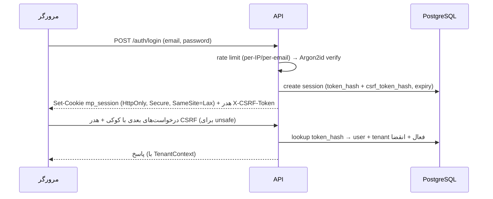

# استراتژی امنیت MarginPilot (نسخهٔ اصلاح‌شدهٔ بازبینی Phase 1)

**مرجع طراحی:** OWASP Top 10 و OWASP ASVS (سطح L2). تغییرات این نسخه نسبت به قبل: CSRF متصل به نشست (مقاوم به Cookie Injection)، حذف کامل JWT از بازیابی رمز، سیاست ثبت‌نام و حاکمیت Owner/عضویت، مجوز دانلودها، فهرست مجوزهای هماهنگ با API.
**پیاده‌سازی از Phase 3 به تدریج با تست امنیتی متناظر هر کنترل انجام می‌شود.**

## ۱) نشست (Opaque Session در PostgreSQL — بدون هیچ JWT)

- **توکن نشست:** ۳۲ بایت تصادفی از CSPRNG؛ فقط `SHA-256(token)` در DB — لو رفتن DB معنایش سرقت نشست ندارد.
- **کوکی:** `HttpOnly` + `Secure` (در HTTPS) + `SameSite=Lax` + `Path=/`.
- **انقضا:** idle (پیش‌فرض ۷ روز) و absolute (پیش‌فرض ۳۰ روز)؛ `last_seen_at` حداکثر یک‌بار در دقیقه.
- **ابطال فوری:** logout، تغییر رمز، revoke نشست، غیرفعال‌سازی کاربر، لغو عضویت (§۹) → همهٔ درخواست‌های بعدی 401.
- **بازیابی رمز — یک مکانیسم واحد (تصمیم بازبینی):** توکن تصادفی یک‌بارمصرف (CSPRNG)، ذخیرهٔ هش در `password_reset_tokens`، انقضای ≤۱۵ دقیقه، مصرف‌شدن → `used_at` و غیرقابل استفاده مجدد، پاسخ همیشه یکسان (بدون افشای وجود ایمیل)، ابطال همهٔ نشست‌ها پس از reset موفق. **JWT در هیچ جای v1 استفاده نمی‌شود** (`PyJWT` از وابستگی‌ها حذف شد؛ `APP_SECRET` فقط رزرو برای نیازهای امضای آینده است).

## ۲) CSRF — توکن متصل به نشست (اصلاحیهٔ Cookie Injection)

الگوی قبلی (double-submit با کوکی قابل‌خواندن JS) در برابر **Cookie Injection** (مثلاً از طریق subdomain مصحوح) مقاوم نیست: مهاجم می‌تواند کوکی `mp_csrf` را با مقدار دلخواه بگذارد و فرانت‌اند همان مقدار را در هدر می‌فرستد. **طرح اصلاح‌شده — بدون کوکی CSRF:**

1. در ساخت هر نشست، توکن CSRF جداگانهٔ تصادفی تولید و فقط `SHA-256(csrf_token)` در `sessions.csrf_token_hash` ذخیره می‌شود.
2. مقدار خام توکن فقط از طریق هدر پاسخ `X-CSRF-Token` (روی login و `GET /auth/me`) به کلاینت تحویل می‌شود؛ کلاینت آن فقط در حافظهٔ برنامه نگه می‌دارد.
3. هر متد unsafe روی نشست، باید همین توکن را در هدر `X-CSRF-Token` بفرستد؛ سرور هش می‌کند و با `csrf_token_hash` نشست مقایسه می‌کند → عدم تطابق: 403.
4. **چرا مقاوم است:** مهاجم Cookie Injection نمی‌تواند (الف) هدر درخواست قربانی را تنظیم کند (CSRF کلاسیک)، (ب) مقداری تولید کند که هشِ آن با هش ذخیره‌شده برابر شود، (ج) هدر پاسخ را بخواند (SOP). توکن به نشست متصل است و با آن می‌میرد.
5. لایهٔ دوم: بررسی `Origin`/`Referer` در برابر whitelist `CORS_ORIGINS` برای همهٔ unsafeها. لایهٔ سوم: SameSite=Lax کوکی نشست.

**رفتار دقیق CSRF در هر عملیات:**

| عملیات | نیازمند توکن CSRF؟ | توضیح |
|---|---|---|
| login / register | ❌ | هنوز نشست و توکنی وجود ندارد؛ جبران: بررسی Origin + rate limit سخت‌گیرانه (§۹) |
| logout | ✅ | هر unsafe نشست‌دار |
| تغییر tenant فعال | ✅ | بازاعتبارسنجی membership در لحظه |
| تغییر رمز | ✅ | + ابطال سایر نشست‌ها |
| همهٔ mutateهای دامنه (محصول/سفارش/هزینه/import/…) | ✅ | قاعدهٔ عمومی |
| تولید گزارش (POST /reports) | ✅ | |
| reset-confirm | ❌ | بدون نشست؛ احراز با توکن یک‌بارمصرف خودِ reset |
| دانلودها (GET) | ❌ | GET امن است؛ مجوز و scope طبق §۹ |

**قواعد دقیق Origin/Referer (اصلاحیهٔ نهایی — شامل login/register):**
1. اگر هدر `Origin` موجود است → باید دقیقاً با یکی از مقادیر `CORS_ORIGINS` برابر باشد؛ غیر از آن → `403` (پیام عمومی).
2. اگر `Origin` غایب است → هدر `Referer` بررسی می‌شود (origin آن باید با whitelist مطابقت داشته باشد).
3. اگر **هر دو غایب** هستند → `403 CSRF_ORIGIN_MISSING`. دلیل: SPA با `fetch` همیشه `Origin` می‌فرستد؛ درخواست فاقد هر دو، رفتار کلاینت غیرمرورگری/مشکوک است و در v1 رد می‌شود. (کلاینت‌های native در آینده با مکانیسم مستند جداگانه — مثل API key — پوشش داده می‌شوند، نه با استثنای CSRF.)
4. تست متناظر: unsafe بدون Origin/Referer، با Origin غلط، با Referer غلط، با Origin درست — سه حالت اول 403، حالت آخر ادامهٔ زنجیرهٔ CSRF.

## ۳) Tenant Isolation — سه لایهٔ نرم‌افزاری + تضمین دیتابیس

- tenant فعال در نشست ذخیره می‌شود؛ جابه‌جایی فقط بین membershipهای فعال (`POST /tenants/{id}/activate`).
- **اجرا در چهار لایه:** (۱) TenantContext اجباری در middleware، (۲) همهٔ Repository queryها با `tenant_id`، (۳) تست IDOR، (۴) — جدید طبق بازبینی — **FKهای مرکب tenant-aware در دیتابیس** (`data-model.md §۴`): PostgreSQL خودش جلوی ارجاع رکورد Tenant A به والد Tenant B را می‌گیرد؛ فیلتر کد به‌تنهایی کافی نیست.
- منابع دیگر tenantها → `404` (بدون افشای وجود).
- **تست الزامی:** IDOR روی همهٔ منابع + تست یکپارچگی FK بین‌tenant در سطح DB (تلاش برای insert متقاطع باید با violation شکست بخورد).

## ۴) RBAC — ماتریس و فهرست مجوزها (هماهنگ با API §۶)

نقش‌ها سراسری‌اند: `owner`, `admin`, `analyst`, `viewer`, `platform_admin` (تصمیم بازبینی — نقش سفارشی tenant در v1 نداریم).

فهرست مجوزها (۲۰ کد): `product:read/write` · `supplier:read/write` · `sales:read/write` · `expense:read/write` · `import:read/execute` · `pricing:read` · `analytics:read` · `report:read/generate` · `comparison:read/write` · `member:read/manage` · `tenant:manage` · `settings:write`.

| مجوز | owner | admin | analyst | viewer | platform_admin |
|---|---|---|---|---|---|
| product / supplier / sales / expense :read | ✅ | ✅ | ✅ | ✅ | ❌ |
| product / supplier / sales / expense :write | ✅ | ✅ | ❌ | ❌ | ❌ |
| import:execute | ✅ | ✅ | ✅ | ❌ | ❌ |
| import:read | ✅ | ✅ | ✅ | ✅ | ❌ |
| pricing:read · analytics:read · report:read | ✅ | ✅ | ✅ | ✅ | ❌ |
| report:generate | ✅ | ✅ | ✅ | ❌ | ❌ |
| comparison:read | ✅ | ✅ | ✅ | ✅ | ❌ |
| **comparison:write (ایجاد و تأیید مقایسه)** | ✅ | ✅ | ❌ | ❌ | ❌ |
| member:read | ✅ | ✅ | ✅ | ✅ | ❌ |
| member:manage | ✅ | ✅ | ❌ | ❌ | ❌ |
| settings:write | ✅ | ✅ | ❌ | ❌ | ❌ |
| tenant:manage | ✅ | ❌ | ❌ | ❌ | ❌ |
| endpointهای پلتفرم | ❌ | ❌ | ❌ | ❌ | ✅ |

- اعتبار فقط سمت Backend (`require_permission(...)` در dependency FastAPI)؛ Frontend فقط UI را تطبیق می‌دهد.
- **platform_admin هیچ دسترسی به دادهٔ tenant ندارد**؛ فقط مدیریت حساب سطح پلتفرم با Audit کامل — و **نقش است، نه کد مجوز** (فهرست ۲۰ کد بالا کامل است).
- **تصمیم صریح (اصلاحیهٔ نهایی):** `comparison:write` هم ایجاد اجرای مقایسه را پوشش می‌دهد هم تأیید تطبیق‌ها → **Analyst فقط comparison:read دارد** و در v1 نمی‌تواند مقایسه بسازد یا تأیید کند (فقط owner/admin)؛ قابل بازنگری در بازبینی بعد.
- سازگاری endpoint↔مجوز در `api-contract §۶` و کنترل خودکار آن در CI از Phase 3.

## ۵) جلوگیری از حملات رایج

| تهدید | کنترل | تست متناظر |
|---|---|---|
| Brute force ورود | rate limit (5/min per IP+email) + قفل تدریجی (10 خطا → 15 دقیقه) + پیام عمومی | پیمایش تلاش‌ها → 429/قفل |
| CSRF (با فرض Cookie Injection) | توکن متصل به نشست (§۲) + Origin check | mutate بدون هدر/هدر غلط/Origin خارجی → 403؛ تزریق کوکی جعلی → 403 |
| SQL Injection | فقط SQLAlchemy پارامتری؛ raw SQL ممنوع | payloadهای مخرب در فیلترها |
| XSS | escaping پیش‌فرض React؛ ممنوعیت `dangerouslySetInnerHTML`؛ CSP | رندر ورودی مخرب |
| IDOR | TenantContext + scope + **FK مرکب DB** + 404 | IDOR suite همهٔ منابع + تست FK متقاطع |
| Privilege escalation | RBAC سمت سرور + قواعد Owner (§۹) | escalation suite + تست Owner |
| SSRF | v1 هیچ fetch سمت سرور به URL کاربر ندارد | — |
| Path Traversal | نام فایل سمت سرور (UUID + پسوند whitelist) | نام مخرب `../../etc/passwd` |
| Session abuse | ابطال فوری، انقضای دوگانه، هش توکن، بدون توکن در localStorage | ابطال پس از logout/تغییر رمز/لغو عضویت |

## ۶) امنیت فایل آپلود (Import)

1. حجم: `UPLOAD_MAX_MB` (۲۵MB) — رد قبل از parse با 413.
2. نوع: پسوند whitelist (`csv`, `xlsx`) + MIME + **magic bytes** (`PK\x03\x04`).
3. رد قطعی `xlsm`/ماکرو: جستجوی `vbaProject.bin` در zip → رد؛ openpyxl فقط `read_only=True, data_only=True` — **هرگز** فرمول/ماکرو اجرا نمی‌شود.
4. Zip bomb: سقف حجم uncompressed، تعداد/عمق entry، نسبت فشرده‌سازی.
5. CSV: سقف ستون/ردیف (`IMPORT_MAX_ROWS`)، encoding.
6. نگهداری: نام امن (UUID) در `upload-tmp/` خارج از web root؛ حذف خودکار پس از commit/خطای نهایی.
7. هیچ فایل آپلودی به‌عنوان کد اجرا یا serve نمی‌شود.

## ۷) Security Headers (در Caddy + FastAPI)

`Strict-Transport-Security` (Caddy) · `X-Content-Type-Options: nosniff` · `X-Frame-Options: DENY` · `Referrer-Policy: strict-origin-when-cross-origin` · `Permissions-Policy` حداقلی · `CSP: default-src 'self'` (دقیق‌سازی و تست در Phase 12).

## ۸) Secrets و Audit

- Secrets فقط از environment؛ `.env` خارج از Git؛ `.env.example` بدون مقدار واقعی؛ gitleaks در CI (Phase 2).
- لاگ هرگز شامل رمز/توکن/کوکی/PII نیست؛ middleware redact دارد.
- **Audit events:** auth.login.success/failed، auth.logout، password.change/reset، session.revoked، tenant.switched/created، member.added/role_changed/removed/owner_protected، idempotency.replay؟ (خیر — لاگ تجاری نیست) — همهٔ create/update/delete/status-transitionهای دامنه + comparison.run/confirm، با user_id، tenant_id، entity، detail، ip.
- **نگهداری audit:** ≥ ۴۰۰ روز (`AUDIT_RETENTION_DAYS`)؛ پاک‌سازی دوره‌ای خودکار؛ حذف دستی ممنوع.

## ۹) حاکمیت ثبت‌نام، Owner و عضویت (اصلاحیهٔ بازبینی)

- **سوءاستفاده از ثبت‌نام:** rate limit `RATE_LIMIT_REGISTER_PER_HOUR` (۳/ساعت per-IP) + rate limit عمومی + پرچم `ALLOW_REGISTRATION` (قابل بستن در production) + سقف `MAX_TENANTS_PER_USER=5` + blacklist نام tenant (slug رزرو: api، admin، www، mail و…).
- **تأیید ایمیل:** در v1 وجود ندارد (سرویس ایمیل خارج از scope) — محدودیت مستند؛ ریسک حساب‌های جعلی با rate limit و کنترل ادمین پلتفرم مهار می‌شود؛ در فاز بعدي با سرویس ایمیل اضافه می‌شود.
- **تنها Owner (هم‌زمانی-امن — اصلاحیهٔ نهایی):** حذف یا تنزل **آخرین/تنها** Owner هر tenant ممنوع → `409 SOLE_OWNER_PROTECTED` + Audit (`member.owner_protected`). الگوی اجرا: کل عملیات تغییر نقش/حذف عضو در **یک تراکنش** با `SELECT ... FOR UPDATE` روی همهٔ membershipهای فعالِ owner همان tenant انجام می‌شود (سریال‌سازی عملیات هم‌زمان)، سپس شمارش ownerهای فعال بررسی می‌شود؛ اگر تنها Owner بود → rollback. با این قفل، دو درخواست هم‌زمانِ «حذف owner» هرگز هر دو عبور نمی‌کنند. اندیس partial unique در DB برای «دقیقاً یک owner فعال» به‌عنوان سخت‌سازی آینده مستند است (نیازمند denormalize کردن نقش در memberships). انتقال مالکیت در v1 خارج از scope است (مستند).
- **لغو عضویت و نشست‌های فعال:** با لغو عضویت (یا غیرفعال شدن)، همهٔ نشست‌های فعال آن کاربر که tenant فعالشان همان tenant است فوراً به‌روزرسانی می‌شوند: اگر membership فعال دیگری دارد → tenant فعال نشست به آن tenant تغییر می‌کند؛ وگرنه `tenant_id` نشست NULL می‌شود و کاربر باید tenant انتخاب کند (هر درخواست tenant-less → `403` با پیام انتخاب tenant). اگر کاربر deactivated شود → کل نشست‌هایش ابطال می‌شود.
- **تغییر tenant فعال:** در لحظهٔ activate، membership دوباره اعتبارسنجی می‌شود؛ نشست‌های دیگر همان کاربر دست‌نخورده می‌مانند.

## ۱۰) مجوز دانلودها (اصلاحیهٔ بازبینی)

| منبع | مجوز | شرط‌ها |
|---|---|---|
| `GET /reports/{id}/download` | report:read | فقط reportهای `completed` **همان tenant**؛ دانلود مستقیم از API با احراز هویت (بدون URL عمومی/امضاشده در v1) |
| `GET /imports/{id}/error-report.xlsx` | import:read | فقط importهای همان tenant؛ scope با FK مرکب تضمین می‌شود |

## ۱۱) نگاشت OWASP Top 10 (2021)

| ریسک | کنترل‌های MarginPilot |
|---|---|
| A01 Broken Access Control | TenantContext + RBAC سمت سرور + FK مرکب DB + IDOR/escalation tests + 404 متقاطع |
| A02 Cryptographic Failures | Argon2id، CSPRNG، هش توکن نشست/CSRF/reset، TLS اجباری در Caddy |
| A03 Injection | ORM پارامتری، Pydantic، بدون اجرای محتوای فایل |
| A04 Insecure Design | این سند + ADRها + two-phase import + formula_version + idempotency |
| A05 Security Misconfiguration | .env خارج از Git، fail-fast config، headers، docs غیرفعال در prod |
| A06 Vulnerable Components | pin نسخه‌ها + pip-audit/npm audit در CI |
| A07 Auth Failures | rate limit + lockout + انقضا + ابطال + پیام عمومی + سیاست ثبت‌نام |
| A08 Data Integrity | Audit، سوابق مالی تغییرناپذیر، Idempotency با ذخیره‌سازی، FK مرکب |
| A09 Logging Failures | لاگ ساختاری بدون PII + audit_logs + request_id |
| A10 SSRF | عدم وجود fetch سمت سرور به URL کاربر در v1 |

## ۱۲) باقی‌مانده‌های امنیتی برای فازهای بعد

CSP دقیق و تست‌شده (Phase 12) · dependency scanning فعال (Phase 2) · IDOR خودکار روی همهٔ endpointها (Phase 12) · Backup security و restore drill (Phase 14) · تأیید ایمیل (بعد از سرویس ایمیل) · rate limit per-tenant در tenant_settings (بعد از v1).
